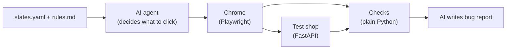

# Agentic State-Traversal Tester

**TL;DR:** An AI agent opens a real browser, places an order in a small test shop, and takes it through every stage (paid, allocated, shipped, delivered). After each stage my code checks whether things actually worked. If something breaks, it writes a bug report saying where it broke and why, with the logs to prove it.

## Why I built this

Testing an order flow by hand means creating a test order, clicking through every stage, opening DevTools, and copying errors over to a coding assistant. Some bugs only show up this way, like a background job failing silently or the screen showing an old status. I wanted to automate that whole loop.

## How it works



1. `spec/states.yaml` lists the order stages in order. `spec/rules.md` has five business rules (R1 to R5) that describe what should happen.
2. The tester opens Chrome with Playwright, with two tabs: the customer page and the admin page.
3. For each stage, an AI agent (Gemini, through LangChain/LangGraph) gets a small task like "mark the order shipped". It can only see a short summary of what's on screen and act through a few tools: click, fill, switch tab, look up a rule, finish.
4. After each stage, normal Python code (not the AI) checks three things: the backend status, the status the customer sees on screen, and any errors in the browser console, network calls or server logs.
5. On the first failure it stops, hides personal data (names, emails, phones), and asks the AI once to write a bug report. The report is saved in `reports/`.

The AI only decides what to click and writes the report. Pass/fail is always decided by code.

The test shop (`app/`) has three bugs I added on purpose, which you can switch on with `BUGS`:

| Bug | What goes wrong |
|---|---|
| `allocation` | The order gets stuck at PAID; the error shows up only in the server logs |
| `stale_ui` | After shipping, the customer page still shows the old status |
| `deliver_500` | "Mark delivered" crashes the server (HTTP 500) |

## Setup

You need Python 3.10+ and a free Gemini API key from https://aistudio.google.com/apikey.

```powershell
py -3.10 -m venv .venv
.venv\Scripts\activate
pip install -r requirements.txt
playwright install chromium
copy .env.example .env    # then put your key in GOOGLE_API_KEY
```

## Running it

Terminal 1, start the shop. Set `BUGS` to one of the bugs above, or leave it empty:

```powershell
$env:BUGS="stale_ui"; uvicorn app.main:app
```

Terminal 2, run the tester:

```powershell
python -m tester walk                  # all stages
python -m tester walk --until ship     # stop after shipping
python -m tester walk --headed         # watch the browser
```

A full run takes about 2 to 3 minutes, mostly because I slow down the API calls to stay inside Gemini's free limits.

## Results

I ran each case with the real model:

| BUGS | Where it failed | Rule cited |
|---|---|---|
| none | didn't fail, all stages passed | - |
| `allocation` | allocate | R2 |
| `stale_ui` | ship | R4 |
| `deliver_500` | deliver | R5 |

A real report is in [samples/deliver_500-report.md](samples/deliver_500-report.md).

To test without an API key:

```powershell
pytest -q tests                  # small unit tests
python tests/scripted_walk.py    # full run with a fake AI that clicks a fixed script
```

## Things I learned

- My first check failed on a perfectly clean run. The order moves from PAID to ALLOCATED by itself about 1 second after payment, so by the time I checked, it was already past PAID. Now I check the order's status history instead of only its current status.
- Gemini's free tier for the main Flash model allows only 20 requests a day, which is about two runs. I switched to Flash-Lite, which has its own separate limit.
- The AI once said a payment "failed" because the page hadn't refreshed yet. I fixed the prompt to tell it to just do the action and leave checking to the code.

More on the prompt changes is in [AI_USAGE.md](AI_USAGE.md). Full technical details are in [summary.md](summary.md).

## What I'd add next

- Save each run's clicks so later runs can replay them without calling the AI
- Run it automatically on pull requests with GitHub Actions
- Support order flows that branch, like cancellations and returns
